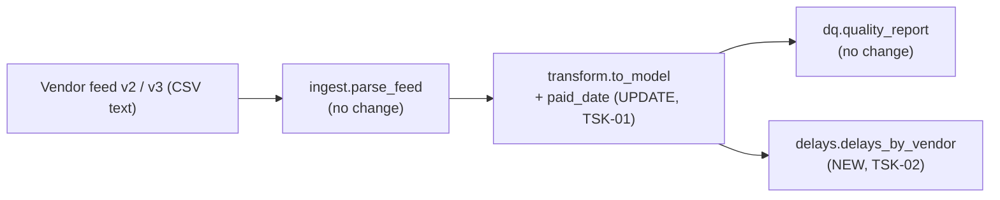

<!-- input task.components for DE-05: from hobasa-data-engineering-agent/outputs/FEAT-ZD-48600/task.components.md at commit 7cb32bd, produced by DE-04 -->
# task.components: FEAT-ZD-48600

Sources, pipelines and components that the Data Engineering lane must create or update for FEAT-ZD-48600 ("Show which overdue invoices belong to vendors that usually pay late"), with the smallest change to the ingestion layer. This is step DE-04, Identify the sources/pipelines to be changed (Ingestion). It has no human gate. Automated checks, the independent judge and sampled human evaluation review it.

| Field | Value | Source |
|---|---|---|
| Trace ID | FEAT-ZD-48600 | record:brief |
| Step | DE-04 Identify the sources/pipelines to be changed (Ingestion) | record:brief |
| Owner | Data engineer | record:brief |
| Inputs | feat.tasks (b0fd4d2), feat.design (722a98f), org.data_model (e8afce8), task.repo_access (daae080) | record:brief |
| Lane tasks in scope | TSK-01 (STORY-01, size M) and TSK-02 (STORY-02, size S), both in ap_pipeline | feat.tasks (section 1); task.repo_access |
| Repository state | ap_pipeline on `feature/story` at `3fcbe1b`, write access confirmed | task.repo_access |
| Code read | `src/ap_pipeline/` and `tests/` from the step's tool view; `data/sample_feed.csv` and `README.md` from the checkout | tool:repo; file:ap_pipeline/data/sample_feed.csv; file:ap_pipeline/README.md |

## 1. Existing sources and pipeline (as read)

| Element | What it does today | Source |
|---|---|---|
| Source: vendor invoice feed | CSV with a header row. The pipeline receives it as text (`csv_text`); the repository code does not fetch it from any location | tool:repo (`ingest.py`, `pipeline.py`) |
| Sample feed | `data/sample_feed.csv` has the header `invoice_id,vendor,due_date,amount,paid` (no `paid_date` column) | file:ap_pipeline/data/sample_feed.csv |
| Pipeline flow | Vendor invoice feed → Invoice Data Model → data-quality report | file:ap_pipeline/README.md |
| Ingestion: `ingest.parse_feed(csv_text)` | `csv.DictReader` over the text; returns one `dict` of strings per row, keyed by the header | tool:repo (`ingest.py`) |
| Transformation: `transform.to_model(rows)` | Maps rows to the Invoice model (`id`, `vendor`, `due_date`, `amount`, `paid`); a row is rejected with the exception class name as reason | tool:repo (`transform.py`) |
| Data quality: `dq.quality_report(records, rejected)` | Returns `rows`, `loaded`, `rejected` and the sorted set of `reject_reasons` | tool:repo (`dq.py`) |
| Pipeline: `pipeline.run(csv_text)` | Ingest, then transform, then the data-quality report; returns `(records, report)` | tool:repo (`pipeline.py`) |
| Schedule | `schedule.json`: daily, `02:00`, `Asia/Kolkata` | tool:repo (`schedule.json`) |
| Package version | `__version__ = "0.4.0"` | tool:repo (`__init__.py`) |
| Storage / Databricks | None. No repository uses Databricks or a database | task.repo_access (section 1) |

## 2. Change in the source

| Source | Change | Source |
|---|---|---|
| Vendor invoice feed v2 → v3 | Feed v3 adds the column `paid_date` (date or None). Feed v2 (no `paid_date` column) must still load | org.data_model; feat.design (B1.3, NF-4); feat.tasks (TSK-01 goal) |
| Data model | Invoice gains `paid_date (date or None)`; all other fields unchanged | org.data_model; feat.design (DC-1) |

No new source system, connection or feed is added (feat.design DD-1, A1).

## 3. Ingestion layer: components to create or update

The minimum change to the ingestion layer is **no change**. `csv.DictReader` keys each row by the header, so a v3 header carries `paid_date` into each row dict by itself, and a v2 header simply has no `paid_date` key (tool:repo `ingest.py`; feat.design B1.3: "`paid_date` key may be missing (feed v2) or `None` (short row)"). Reading the new column is done in the transformation step (HC-1).

| Component | File | Action | Why | Source |
|---|---|---|---|---|
| `ingest.parse_feed` | `src/ap_pipeline/ingest.py` | **No change** | DictReader already passes any header column through | tool:repo (`ingest.py`); feat.design (HC-3, B1.1); feat.tasks (TSK-01 "Must not change") |
| `pipeline.run` | `src/ap_pipeline/pipeline.py` | **No change** | `delays_by_vendor` is called by the caller on `records`, not inside `run` | feat.design (HC-3, B1.1, B5); feat.tasks (TSK-01 "Must not change") |
| `dq.quality_report` | `src/ap_pipeline/dq.py` | **No change** | The new reason `'paid_date'` flows into `reject_reasons` by itself | feat.design (HC-3); tool:repo (`dq.py`) |
| Schedule | `src/ap_pipeline/schedule.json` | **No change** (daily, 02:00, Asia/Kolkata) | Frequency is not part of this feature | feat.design (B1.1, A4); feat.tasks (TSK-01 "Must not change") |
| Sample feed | `data/sample_feed.csv` | **No change** | Not in any task's files in budget; v3 behaviour is built on synthetic v3 rows in the tests | feat.tasks (TSK-01, TSK-02 "Files in budget"; TSK-01 "build on synthetic v3 rows") |

## 4. Pipeline components the lane changes (carried to DE-07 and DE-08)

These are the only files the lane touches, all inside the task budgets.

| # | Component | File | Action | Task / story | Source |
|---|---|---|---|---|---|
| 1 | `to_model` + private `_parse_paid_date`, constant `PAID_DATE_REASON = "paid_date"` | `src/ap_pipeline/transform.py` | **Update, additive.** Keep the existing `try` block as is; parse `paid_date` only for a row that passed it; reject a non-blank invalid value with reason `'paid_date'`; add the `paid_date` key (a `date` or `None`) to every record. Signature and `(records, rejected)` return shape unchanged; `due_date` parsing unchanged | TSK-01 / STORY-01 (HC-1) | feat.tasks (TSK-01); feat.design (B1.2, DD-6, DD-7) |
| 2 | `delays_by_vendor(records: Iterable[Dict]) -> Dict[str, List[int]]` | `src/ap_pipeline/delays.py` (new) | **Create.** Pure function: `(paid_date - due_date).days` for paid records with a `paid_date`; feed order; vendors in first-seen order; negative values kept; input not modified | TSK-02 / STORY-02 (HC-2) | feat.tasks (TSK-02); feat.design (B1.2) |
| 3 | `__version__` | `src/ap_pipeline/__init__.py` | **Update, version step only** (one minor step, owned by TSK-01; next number for the lane to confirm). No `__all__` added | TSK-01 | feat.tasks (section 2; TSK-02 "Must not change"); feat.design (DD-11, DQ-4) |
| 4 | paid_date tests | `tests/test_pipeline.py` | **Update.** Add the TSK-01 tests (`test_paid_date_empty_is_none` to `test_unpaid_row_keeps_paid_date`); existing `test_run_maps_and_rejects`, `test_paid_flag`, `test_missing_column_rejected` unchanged | TSK-01 | feat.tasks (TSK-01 "Tests to add"); tool:repo (`test_pipeline.py`) |
| 5 | Delay-history tests | `tests/test_delays.py` (new) | **Create.** `test_delays_by_vendor_*` cases | TSK-02 | feat.tasks (TSK-02 "Tests to add") |

Build order inside the lane: TSK-01 first, then TSK-02 (it reads the `paid_date` key) (feat.tasks section 1; feat.design Part C "Lane dependencies").

## 5. Secrets in all environments

The ap_pipeline source reads no secret, credential or environment variable. A search of `src/` for secret, token, password, API-key and environment-variable patterns found no match, and the pipeline takes the feed as a text argument (tool:repo). This feature adds no secret (feat.design SE-4). So this lane needs no secret access in any environment for TSK-01 and TSK-02. The DE-02 output (task.secrets_scope) is not an input to this step, so it is not cross-checked here (open question CQ-DE4-3).

## 6. What stays out of this lane

| Item | Owner | Source |
|---|---|---|
| `vendor_risk`, `build_explanation_request(risk=None)` | Data Science / ap_forecast (TSK-03, TSK-04) | feat.tasks (section 1) |
| `overdue_with_risk`, `overdue_rows_to_json` | Backend / ap_aging (TSK-05, TSK-06) | feat.tasks (section 1) |
| `renderOverdueRisk` | Frontend / ap_portal (TSK-07) | feat.tasks (section 1) |
| End-to-end harness | Testing Agent (TSK-08), test asset only | feat.tasks (TSK-08); feat.design (HC-10) |
| Production wiring of the stages | Not given in any input (DQ-1) | feat.design (A4, DQ-1) |

## 7. Open questions (non-blocking)

| ID | Question | Interim answer | Owner (proposed) |
|---|---|---|---|
| CQ-DE4-1 | Feed v3 (with `paid_date`) must be in production before release; ZD-48470 brings feed v2 (PQ-6). When will v3 arrive? | Code and tests are built on synthetic v3 rows; feed v2 keeps loading. Gates release only, not coding | Product manager / Data engineering lead |
| CQ-DE4-2 | `data/sample_feed.csv` stays a v2 sample with no `paid_date` column. Should a synthetic v3 sample be added later? | No: it is outside the TSK-01 and TSK-02 file budgets | Data engineering lead |
| CQ-DE4-3 | Confirm against task.secrets_scope (DE-02) that the lane needs no secrets in any environment | No secrets: none are read by the code | Data engineering lead |
| CQ-DE4-4 | The column name `paid_date` comes from the data model and the design; no feed v3 specification is in the inputs | Use `paid_date` as in org.data_model and feat.design | Data modeler |

Carried, unchanged: RAQ-1 to RAQ-3 (task.repo_access), DQ-1 and DQ-4 (feat.design), TKQ-1 to TKQ-3 (feat.tasks).

No blocking questions.
