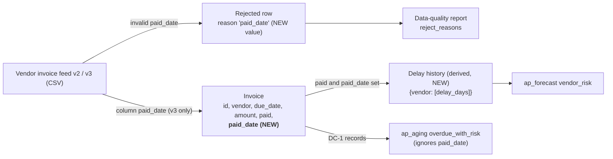

<!-- input feat.data_model_change for DE-06: from hobasa-data-engineering-agent/outputs/FEAT-ZD-48600/feat.data_model_change.md at commit 3943254, produced by DE-05 -->
# feat.data_model_change: FEAT-ZD-48600

Data Model change for FEAT-ZD-48600 ("Show which overdue invoices belong to vendors that usually pay late"). This is step DE-05, Data Model Changes. The step has no human gate; automated checks, the independent judge and sampled human evaluation review it. The next step, DE-06 Data Mapping, reads this file.

| Field | Value | Source |
|---|---|---|
| Trace ID | FEAT-ZD-48600 | record:brief |
| Step | DE-05 Data Model Changes | record:brief |
| Owner | Data engineer | record:brief |
| Workbook action | Update the data model based on the source systems and ingested data | record:brief |
| Contracted inputs | task.components (7cb32bd), org.data_model (e8afce8) | record:brief |
| Background read | feat.design (722a98f): DC-1, DC-2, B1.2 to B1.4, DD-6, DD-7, NF-4 | journey:feat.design |
| Other file read | `org/org.data_model.md` (organisation baseline, before the feature override) | file:hobasa-agentic-sdlc/org/org.data_model.md |
| Code read | `src/ap_pipeline/` (`ingest.py`, `transform.py`, `dq.py`, `pipeline.py`, `schedule.json`, `__init__.py`) from the step's tool view | tool:repo |

## 1. Summary of the change

The **Invoice** entity gains one attribute, `paid_date (date or None)`, sourced from a new column `paid_date` that vendor feed v3 adds. Every other attribute stays as it is. Feed v2, which has no `paid_date` column, must keep loading (org.data_model; task.components section 2; journey:feat.design NF-4).

Two further, smaller changes follow from it. Neither is a new stored entity:

- The data-quality reject reasons gain one value, `'paid_date'` (task.components section 3; journey:feat.design B1.3).
- A derived, in-memory **Delay history** view is added: `{vendor: [delay_days, ...]}` (task.components section 4; journey:feat.design DC-2).

No storage, database table or schema migration is involved (journey:feat.design A1 "Data" row; task.components section 1 "Storage / Databricks: None").

## 2. Source system and ingested data (as read)

| Item | Today | After this feature | Source |
|---|---|---|---|
| Source system | Vendor invoice feed: CSV text with a header row | Same source; feed v2 → v3 adds column `paid_date`. No new source, connection or feed | task.components (sections 1, 2) |
| Feed v2 header (sample) | `invoice_id,vendor,due_date,amount,paid` | Still accepted | task.components (section 1) |
| Feed v3 header | — | v2 columns plus `paid_date` | task.components (section 2); org.data_model |
| `paid_date` value in the feed | — | ISO date; empty when unpaid | record:memory (JOURNEY requirement: "optional paid_date column (ISO date, empty when unpaid)") |
| Ingestion (`ingest.parse_feed`) | `csv.DictReader`; one `dict` of strings per row, keyed by the header | No change: a v3 header carries `paid_date` into each row; a v2 header has no `paid_date` key | tool:repo (`ingest.py`); task.components (section 3) |
| Mapping to the model (`transform.to_model`) | Builds `id`, `vendor`, `due_date`, `amount`, `paid` | Adds `paid_date` (implemented in DE-08, TSK-01) | tool:repo (`transform.py`); task.components (section 4, row 1) |

## 3. Data model: before and after

### 3.1 Invoice entity

| Attribute | Type | Before | After | Change | Source |
|---|---|---|---|---|---|
| `id` | str | Yes | Yes | None | org.data_model |
| `vendor` | str | Yes | Yes | None (see open question DMQ-1 on "optional") | org.data_model; file:hobasa-agentic-sdlc/org/org.data_model.md |
| `due_date` | date | Yes | Yes | None | org.data_model |
| `amount` | Decimal, 2 dp | Yes | Yes | None. Decimal, never float | org.data_model; record:memory (D-2026-044, L-011) |
| `paid` | bool | Yes | Yes | None | org.data_model |
| **`paid_date`** | **date or None** | No | **Yes** | **Added** (feed v3) | org.data_model; journey:feat.design (DC-1) |

Updated model line, as the feature override states it:

> Invoice: id (str), vendor (str), due_date (date), amount (Decimal, 2 dp), paid (bool), paid_date (date or None) [paid_date added in feed v3].

(org.data_model)

### 3.2 Attribute specification: `paid_date`

| Property | Value | Source |
|---|---|---|
| Name in the model and in the feed | `paid_date` | org.data_model; task.components (section 2; CQ-DE4-4) |
| Type | Python `datetime.date`, or `None` | org.data_model; journey:feat.design (B1.3) |
| Nullable | Yes. `None` when the feed column is missing (feed v2), the cell is `None` (short row) or the cell is blank | journey:feat.design (B1.3, B1.4) |
| Format in the feed | ISO date, parsed with `date.fromisoformat` after stripping whitespace | journey:feat.design (B1.2); record:memory (JOURNEY requirement) |
| Invalid value | A non-blank value that is not an ISO date rejects the row with reason `'paid_date'` | journey:feat.design (B1.2, B1.4); task.components (section 4, row 1) |
| Precedence | Validated only after the existing fields pass; an invalid existing field keeps today's reason (exception type name) | journey:feat.design (DD-6) |
| Relation to `paid` | Not cross-validated. A paid record without `paid_date` is kept; an unpaid row with a valid `paid_date` is accepted and keeps the date (interim, pending OQ-B6) | journey:feat.design (DD-7, B1.4) |
| Present on every record | Yes: every accepted record carries the `paid_date` key (a `date` or `None`) | task.components (section 4, row 1); journey:feat.design (B1.2 step 3) |

### 3.3 Rejected row and data-quality report

| Structure | Change | Source |
|---|---|---|
| Rejected row `{"row": dict, "reason": str}` | Shape unchanged; one new `reason` value, `"paid_date"` | journey:feat.design (B1.3); task.components (section 4, row 1) |
| `quality_report` → `reject_reasons` | No code change; `'paid_date'` appears in the sorted set when such a row is rejected | task.components (section 3, `dq.quality_report`); tool:repo (`dq.py`) |

### 3.4 Derived view: Delay history (not stored)

| Property | Value | Source |
|---|---|---|
| Shape | `Dict[str, List[int]]`, `{vendor: [delay_days, ...]}` | journey:feat.design (DC-2, B1.3) |
| Rule | `delay_days = (paid_date - due_date).days`, calendar days | task.components (section 4, row 2); record:memory (D-2026-031) |
| Included records | Paid records with a `paid_date` only | task.components (section 4, row 2); journey:feat.design (DC-2) |
| Order | Feed order within a vendor; vendors in first-seen order | task.components (section 4, row 2) |
| Negative delays (early payment) | Kept | task.components (section 4, row 2); journey:feat.design (DC-2) |
| Produced by | `delays.delays_by_vendor(records)` (new module, TSK-02) | task.components (section 4, row 2) |
| Consumer | ap_forecast `vendor_risk(history)`, one vendor's list at a time | journey:feat.design (DC-2) |

### 3.5 Knowledge-graph view

Sources: task.components (section 4 diagram); journey:feat.design (A2, DC-1, DC-2, B3.3).

## 4. Compatibility

| Consumer / case | Effect | Source |
|---|---|---|
| Feed v2 (no `paid_date` column) | Loads as today; every record has `paid_date = None` | journey:feat.design (NF-4, B1.4); task.components (section 2) |
| Existing record keys | Unchanged; `paid_date` is additive | journey:feat.design (DC-1) |
| `to_model` signature and `(records, rejected)` return shape | Unchanged | task.components (section 4, row 1) |
| ap_aging (DC-1 consumer) | Reads `id`, `vendor`, `due_date`, `amount`, `paid`; extra key `paid_date` ignored | journey:feat.design (DC-1, B3.3) |
| Schedule | Unchanged: daily, 02:00, Asia/Kolkata | tool:repo (`schedule.json`); task.components (section 3) |

## 5. Code in ap_pipeline

This step changes no code. The model change is implemented by TSK-01 in DE-08 (`transform.to_model` with `_parse_paid_date` and `PAID_DATE_REASON`) and TSK-02 (`delays.delays_by_vendor`), as task.components section 4 plans. At that point the `transform.py` module docstring, which lists the model as "(id, vendor, due_date, amount, paid)", should also name `paid_date` (tool:repo `transform.py`; task.components section 4).

Current behaviour that the new attribute builds on (tool:repo `transform.py`):

- A missing `invoice_id`, `vendor`, `due_date` or `amount` key raises `KeyError`, and the row is rejected.
- `paid` is read with `r.get("paid", "false")`, so a missing `paid` column means unpaid.
- `amount` is `Decimal(r["amount"])`, with no check on the number of decimals.

`pipeline.run` calls `to_model` on the output of `parse_feed` and passes its result to `quality_report` (tool:repo `pipeline.py`). The repository is on `feature/story` at `3fcbe1b` (task.components).

## 6. Handover to DE-06 (Data Mapping)

| Source column (feed) | Model attribute | Rule |
|---|---|---|
| `invoice_id` | `id` | Unchanged (strip) |
| `vendor` | `vendor` | Unchanged (strip) |
| `due_date` | `due_date` | Unchanged (ISO date) |
| `amount` | `amount` | Unchanged (Decimal) |
| `paid` | `paid` | Unchanged (`"true"`, case-insensitive, after strip; missing → false) |
| `paid_date` (v3, optional) | `paid_date` | **New**: missing, `None` or blank → `None`; ISO date → `date`; otherwise reject with reason `'paid_date'`, after the existing checks pass |

Sources: tool:repo (`transform.py`); journey:feat.design (B1.2, B1.4); org.data_model.

## 7. Open questions (non-blocking)

| ID | Question | Interim position | Owner (proposed) |
|---|---|---|---|
| DMQ-1 | The organisation baseline says `vendor (str, optional)`, but the feature override says `vendor (str)`. Today's code rejects a row with no `vendor` column (`KeyError`), and ap_aging raises `KeyError` for a missing `vendor` (DD-8). Which definition is authoritative after this feature? | Follow the feature override (the contracted input). This feature does not change `vendor` | Data modeler |
| DMQ-2 | Who updates `org/org.data_model.md` with `paid_date` once the feature is released, and when? The override sits only under `features/FEAT-ZD-48600/org-overrides/` | Treat the feature override as the model for this feature | Data engineering lead |
| DMQ-3 | The model says `amount (Decimal, 2 dp)`, but `to_model` does not enforce 2 dp. This gap exists today and this feature does not add to it; ap_aging quantises downstream (DD-10) | No change in this feature | Data modeler |
| CQ-DE4-1 (carried) | When does feed v3 reach production? ZD-48470 brings feed v2 | Build and test on synthetic v3 rows; v2 keeps loading | Product manager / Data engineering lead |
| CQ-DE4-4 (carried) | No feed v3 specification is in the inputs; the column name `paid_date` comes from the data model and the design | Use `paid_date` | Data modeler |
| OQ-B6 (carried) | Should an unpaid row with a valid `paid_date` be accepted? | Accepted, date kept (DD-7) | Product manager |

No blocking questions.
