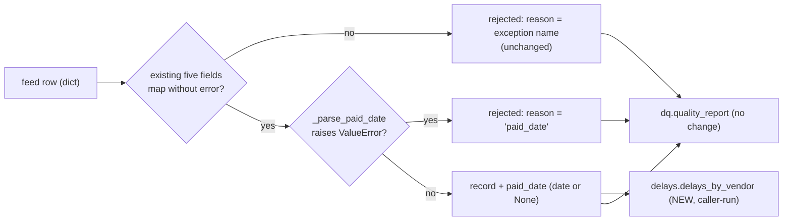

<!-- input task.components for DE-07: from hobasa-data-engineering-agent/outputs/FEAT-ZD-48600/task.components.md at commit 7cb32bd, produced by DE-04 -->
# task.components: FEAT-ZD-48600

This file lists the sources, pipelines and components that the Data Engineering lane must create or update for FEAT-ZD-48600 ("Show which overdue invoices belong to vendors that usually pay late"). Each change is the smallest one that does the job. This step is DE-07, Identify the sources/pipelines to be changed (Transformation). It updates the DE-04 (Ingestion) version of this file: the ingestion findings are carried over unchanged (except that section 6 now closes CQ-DE4-3), and the transformation pipeline is added from feat.mappings. The step has no human gate. Automated checks, the independent judge and sampled human evaluation review it (record:brief).

| Field | Value | Source |
|---|---|---|
| Trace ID | FEAT-ZD-48600 | record:brief |
| Step | DE-07 Identify the sources/pipelines to be changed (Transformation) | record:brief |
| Owner | Data engineer | record:brief |
| Contracted inputs | feat.mappings (f124cd3, from DE-06); task.components (7cb32bd, from DE-04) | record:brief |
| Background read | This lane's DE-02 output task.secrets_scope, to confirm secrets (section 6) | file:hobasa-data-engineering-agent/outputs/FEAT-ZD-48600/task.secrets_scope.md |
| Code read | `__init__.py`, `ingest.py`, `transform.py`, `dq.py`, `pipeline.py`, `schedule.json`, `tests/test_pipeline.py` from the step's tool view. A listing of `src/ap_pipeline/` confirms that `delays.py` does not exist yet | tool:repo |
| Lane tasks in scope | TSK-01 (STORY-01) and TSK-02 (STORY-02), both in ap_pipeline | task.components (section 4) |
| **Result** | **The transformation pipeline needs one update and one new module. `transform.to_model` gets an additive `paid_date` mapping (TSK-01). A new pure function, `delays.delays_by_vendor`, builds the Delay history (TSK-02). `ingest.py`, `dq.py`, `pipeline.py` and `schedule.json` do not change. There is no new source, storage, schedule or secret.** | feat.mappings (sections 2, 3, 4, 5, 7); task.components (sections 3, 4); tool:repo |

## 1. Existing sources and pipeline (as read)

| Element | What it does today | Source |
|---|---|---|
| Source: vendor invoice feed | A CSV with a header row. The pipeline receives it as text (`csv_text`) and fetches it from nowhere itself | tool:repo (`ingest.py`, `pipeline.py`); task.components (section 1) |
| Ingestion: `ingest.parse_feed(csv_text)` | Runs `csv.DictReader` over the text and returns one `dict` of strings per row, keyed by the header | tool:repo (`ingest.py`) |
| Transformation: `transform.to_model(rows)` | In one `try`, builds `{"id", "vendor", "due_date", "amount", "paid"}` and appends it to `records`. On `KeyError`, `ValueError`, `InvalidOperation` or `AttributeError` it appends `{"row": r, "reason": type(e).__name__}` to `rejected`. Returns `(records, rejected)` | tool:repo (`transform.py`) |
| Data quality: `dq.quality_report(records, rejected)` | Returns `rows`, `loaded` and `rejected`, plus `reject_reasons` (the sorted set of every `reason`) | tool:repo (`dq.py`) |
| Pipeline: `pipeline.run(csv_text)` | Calls `parse_feed`, then `to_model`, then `quality_report`, and returns `(records, report)` | tool:repo (`pipeline.py`) |
| Schedule | `schedule.json`: `daily`, `02:00`, `Asia/Kolkata` | tool:repo (`schedule.json`) |
| Package version | `__version__ = "0.4.0"` | tool:repo (`__init__.py`) |
| Delay history | Not present. `src/ap_pipeline/` has no `delays.py` | tool:repo |
| Storage / Databricks | None | task.components (section 1) |

## 2. Change in the source and the mapping

| Item | Change | Source |
|---|---|---|
| Vendor feed v2 → v3 | Feed v3 adds an optional `paid_date` column: an ISO date, empty when the invoice is unpaid. Feed v2, which has no `paid_date` column, must still load | feat.mappings (sections 1, 2); task.components (section 2) |
| Column mapping | One new mapping: `paid_date -> Invoice.paid_date` (`date` or `None`). The `invoice_id`, `vendor`, `due_date`, `amount` and `paid` mappings are unchanged | feat.mappings (Result, section 2) |
| New reject reason | `'paid_date'`, used when a non-blank `paid_date` is not an ISO date | feat.mappings (section 3, steps 3–4) |
| Derived view | Delay history `{vendor: [delay_days, ...]}`, held in memory only | feat.mappings (section 4) |
| Schedule | No change (daily, 02:00, Asia/Kolkata) | feat.mappings (section 5) |

No new source system, connection, feed, stored entity or storage is added (feat.mappings Result; task.components section 2).

## 3. Ingestion layer (carried from DE-04, unchanged)

The ingestion layer needs **no change**. `csv.DictReader` keys each row by the header. A v3 header therefore carries `paid_date` into each row on its own, and a v2 row simply has no `paid_date` key (task.components section 3; tool:repo `ingest.py`; feat.mappings section 3, step 1).

## 4. Transformation pipeline: components to create or update

### 4.1 Component list

| # | Component | File | Action | Smallest change | Task | Source |
|---|---|---|---|---|---|---|
| T1 | `to_model(rows)` | `src/ap_pipeline/transform.py` | **Update, additive** | Map the existing five fields exactly as today. Then, only for a row that passed them, read `paid_date`. Reject an invalid value with reason `'paid_date'`. Add the `paid_date` key to every accepted record. The signature and the `(records, rejected)` return shape stay the same | TSK-01 | feat.mappings (section 3, steps 2–6); task.components (section 4, #1) |
| T2 | `_parse_paid_date(value)` (private helper) | `src/ap_pipeline/transform.py` | **Create** | A missing, `None` or blank value returns `None`. Anything else returns `date.fromisoformat(value.strip())`, and a `ValueError` propagates to `to_model` | TSK-01 | feat.mappings (sections 2, 3 step 3) |
| T3 | `PAID_DATE_REASON = "paid_date"` (module constant) | `src/ap_pipeline/transform.py` | **Create** | The reason string for the new rejection | TSK-01 | feat.mappings (section 3, step 4); task.components (section 4, #1) |
| T4 | Module docstring | `src/ap_pipeline/transform.py` | **Update, text only** | The model list "(id, vendor, due_date, amount, paid)" also names `paid_date` | TSK-01 | feat.mappings (section 7); tool:repo (`transform.py`) |
| T5 | `delays_by_vendor(records)` | `src/ap_pipeline/delays.py` | **Create (new module)** | A pure, in-memory function. Keep records where `paid` is truthy and `paid_date` is not `None`. Compute `delay_days = (paid_date - due_date).days` in calendar days, keeping negative values. Keep values in feed order and vendors in first-seen order. Leave the input unmodified | TSK-02 | feat.mappings (section 3 step 8, section 4); task.components (section 4, #2); record:memory (D-2026-031) |
| T6 | `__version__` | `src/ap_pipeline/__init__.py` | **Update, version step only** | Move up one minor version from `0.4.0`. The next number is still to be confirmed (DQ-4, carried) | TSK-01 | task.components (section 4, #3); tool:repo (`__init__.py`) |

### 4.2 Pipeline components that do not change

| Component | File | Action | Why | Source |
|---|---|---|---|---|
| `parse_feed` | `src/ap_pipeline/ingest.py` | **No change** | See section 3 | task.components (section 3); feat.mappings (section 3, step 1) |
| `quality_report` | `src/ap_pipeline/dq.py` | **No change** | It already lists every rejected `reason` in `reject_reasons`, so `'paid_date'` appears without any code change | feat.mappings (section 3, step 7); tool:repo (`dq.py`) |
| `run` | `src/ap_pipeline/pipeline.py` | **No change** | No change is needed (feat.mappings). The caller runs `delays_by_vendor` on `records`; `run` does not call it (task.components) | feat.mappings (section 3, the line after step 8); task.components (section 3, `pipeline.run` row) |
| Schedule | `src/ap_pipeline/schedule.json` | **No change** | The customer frequency matches the file | feat.mappings (section 5) |
| Sample feed | `data/sample_feed.csv` | **No change** | It is a v2 sample and stays outside the task file budgets. v3 cases use synthetic rows in the tests | task.components (section 3); feat.mappings (section 6) |

### 4.3 Order of steps inside `to_model` (per row)

The order follows feat.mappings section 3. An existing reject reason takes precedence over `'paid_date'` (DD-6).

Today `transform.py` appends the record inside the `try`. For a row with an invalid `paid_date` to produce no record, the record must be appended only after `paid_date` is checked. The five field expressions themselves stay unchanged (tool:repo `transform.py`; feat.mappings section 3, steps 2–5). TCQ-1 records this.

### 4.4 Consumers of the changed data

| Consumer | Reads | Effect | Source |
|---|---|---|---|
| ap_aging (DC-1) | `id`, `vendor`, `due_date`, `amount`, `paid` | Ignores the extra `paid_date` key, so nothing changes for it | feat.mappings (section 4) |
| ap_forecast `vendor_risk(history)` (DC-2) | One vendor's list from `delays_by_vendor` | New input, owned by the Data Science lane | feat.mappings (section 4); task.components (section 6) |

## 5. Tests the transformation change needs (for DE-08 and DE-09)

| # | File | Action | Cases | Task | Source |
|---|---|---|---|---|---|
| U1 | `tests/test_pipeline.py` | **Update** | Add the `paid_date` cases from feat.mappings section 6: v2 header gives `None`; an empty value gives `None`; a valid ISO date is parsed; an invalid date is rejected as `'paid_date'`; an existing reason takes precedence; an unpaid row keeps its date; every record has the six keys. `test_run_maps_and_rejects`, `test_paid_flag` and `test_missing_column_rejected` stay unchanged | TSK-01 | feat.mappings (section 6); task.components (section 4, #4); tool:repo (`tests/test_pipeline.py`) |
| U2 | `tests/test_delays.py` | **Create** | `test_delays_by_vendor_*` cases. This step derives their coverage from the T5 rules: the filter, feed order, first-seen vendor order, negative delays kept, and input not modified | TSK-02 | task.components (section 4, #5); feat.mappings (section 4) |

The test data is synthetic (feat.mappings section 6). The day-count rule should be tested at a boundary day (record:memory L-007), and amounts stay `Decimal` (record:memory D-2026-044, L-011).

## 6. Secrets in all environments

The transformation change needs **no secret in any environment**.

| Check | Finding | Source |
|---|---|---|
| Code | The tool view's `src/ap_pipeline/` modules import only `csv`, `io`, `typing`, `datetime` and `decimal`, plus each other. They read no environment variable, credential or network resource. A case-insensitive search of `src/` for `os.environ`, `getenv`, `secret`, `token`, `password`, `api_key` and imports of `os`, `requests`, `urllib` or `socket` found no match | tool:repo |
| New code | `_parse_paid_date` and `delays_by_vendor` work only in memory on values passed to them | feat.mappings (sections 3, 4) |
| DE-02 scope | "Granted secret names: none"; "this lane's tasks need no secret, and the permission table grants none for ap_pipeline" | file:hobasa-data-engineering-agent/outputs/FEAT-ZD-48600/task.secrets_scope.md |

This closes CQ-DE4-3, the DE-04 question that asked for a cross-check against task.secrets_scope. SSQ-1 from DE-02, about a possible scheduler credential at DE-13, stays open with DE-02 (file:hobasa-data-engineering-agent/outputs/FEAT-ZD-48600/task.secrets_scope.md).

## 7. What stays out of this lane (unchanged from DE-04)

`vendor_risk` and `build_explanation_request` belong to Data Science (ap_forecast). `overdue_with_risk` and `overdue_rows_to_json` belong to Backend (ap_aging). `renderOverdueRisk` belongs to Frontend (ap_portal). The end-to-end harness belongs to Testing. No input describes how the stages are wired in production (DQ-1) (task.components section 6).

## 8. Open questions (non-blocking)

Owners are proposed by this step unless the cited item names one.

| ID | Question | Interim position | Owner (proposed) | Source |
|---|---|---|---|---|
| TCQ-1 | DE-04 said to "keep the existing `try` block as is". To keep a row with an invalid `paid_date` out of `records`, the `records.append(...)` call must move after the `paid_date` check, though the field expressions stay the same. Does this small move count as "as is"? | Yes. Change only where the record is appended; keep every field expression and exception type | Data engineering lead | task.components (section 4, #1); tool:repo (`transform.py`); feat.mappings (section 3) |
| MQ-4 (carried) | Is a whitespace-only `paid_date` blank (giving `None`) or invalid (rejected as `'paid_date'`)? | Unconfirmed. DE-08 must not choose silently; T2 and U1 follow the answer | Data modeler | feat.mappings (section 8) |
| MQ-2 (carried) | Should an unpaid row that has a valid `paid_date` be kept (DD-7), rejected, or have its date cleared? | Keep it. The Delay history leaves it out | Product manager (OQ-B6); feed owner | feat.mappings (section 8) |
| MQ-1 / CQ-DE4-4 (carried) | Can CQ-DE4-4 close now that the customer contract names `paid_date`? | Yes; the mapping uses `paid_date` (feat.mappings MQ-1). The data modeler owns the answer | Data modeler | feat.mappings (section 8); task.components (section 7) |
| MQ-3 / CQ-DE4-1 (carried) | When does feed v3 reach production, and must v2 and v3 load side by side? | The mapping accepts both. This question gates release, not coding | Product manager / Data engineering lead | feat.mappings (section 8); task.components (section 7) |
| CQ-DE4-2 (carried) | Should a synthetic v3 sample feed be added? | No. It is outside the task file budgets | Data engineering lead | task.components (section 7) |

Closed in this step: CQ-DE4-3 (section 6). Carried unchanged: DMQ-1 to DMQ-3 (feat.mappings section 8); RAQ-1 to RAQ-3, DQ-1, DQ-4 and TKQ-1 to TKQ-3 (task.components section 7).

No blocking questions.
